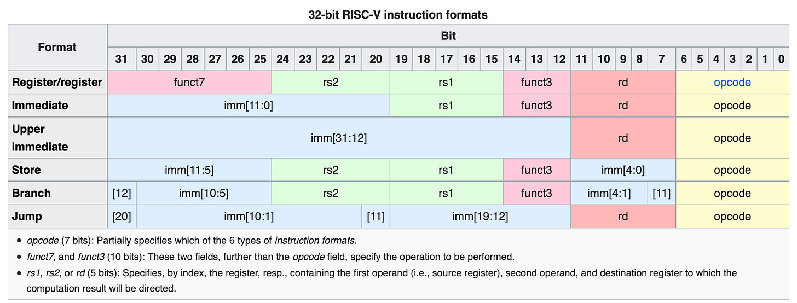
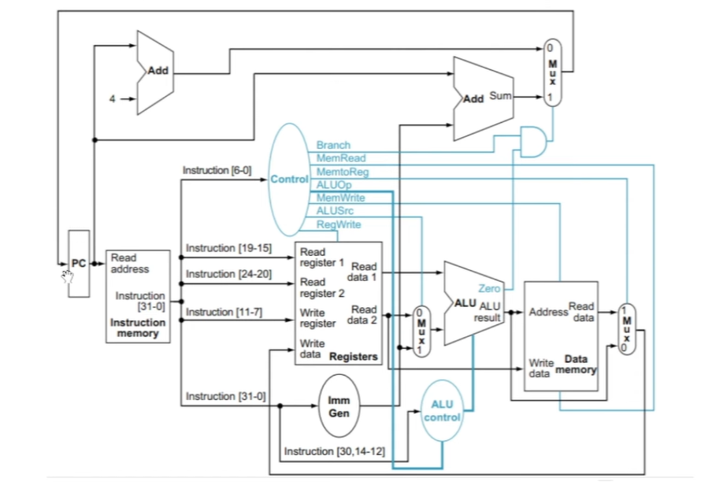
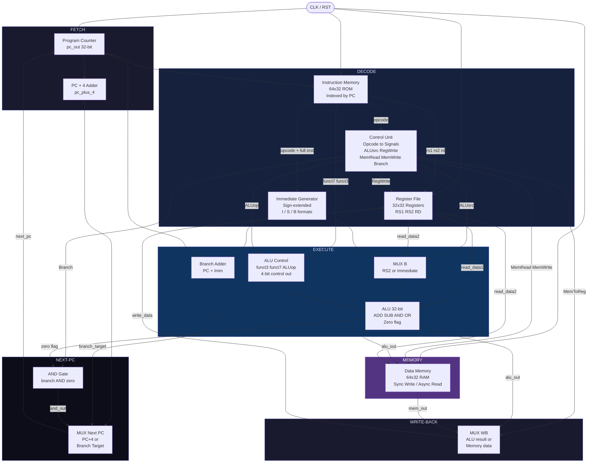
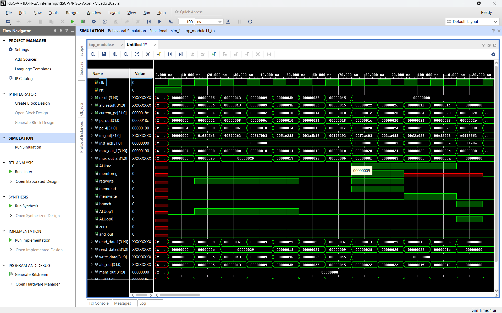

# RISC-V Single-Cycle Processor



> A fully functional 32-bit RISC-V single-cycle processor designed and verified using **Verilog HDL** and simulated on **Xilinx Vivado**.

---

## Table of Contents

- [Overview](#overview)
- [Architecture Diagram](#architecture-diagram)
- [Supported Instructions](#supported-instructions)
- [Module Breakdown](#module-breakdown)
- [Datapath — Instruction Execution Flow](#datapath--instruction-execution-flow)
- [Control Signals Table](#control-signals-table)
- [File Structure](#file-structure)
- [Simulation & Testing](#simulation--testing)
- [Tools Used](#tools-used)

---

## Overview

This project implements a **single-cycle RISC-V (RV32I subset) processor** entirely in Verilog HDL. In a single-cycle design, every instruction — from fetch to write-back — completes within **one clock cycle**. This makes the control logic straightforward and the datapath easy to verify.

The processor supports the following instruction types from the RV32I base integer instruction set:
- **R-type** — Register–Register arithmetic/logic (ADD, SUB, AND, OR)
- **I-type** — Immediate arithmetic + Load word (`LW`)
- **S-type** — Store word (`SW`)
- **B-type** — Conditional branching (`BEQ`)

The processor was verified using a custom testbench (`top_module11_tb.v`) with pre-loaded instruction and register values to validate functional correctness in Vivado simulation.

---

## Architecture Diagram

The diagram below shows the complete datapath and control path of the processor. Data flows left-to-right; control signals flow from the Control Unit.





---

## Supported Instructions

| Instruction | Type   | Opcode      | Operation                              |
|-------------|--------|-------------|----------------------------------------|
| `ADD`       | R-type | `0110011`   | `rd = rs1 + rs2`                       |
| `SUB`       | R-type | `0110011`   | `rd = rs1 - rs2`                       |
| `AND`       | R-type | `0110011`   | `rd = rs1 & rs2`                       |
| `OR`        | R-type | `0110011`   | `rd = rs1 OR rs2`                      |
| `ADDI`      | I-type | `0010011`   | `rd = rs1 + imm`                       |
| `ORI`       | I-type | `0010011`   | `rd = rs1 OR imm`                      |
| `LW`        | I-type | `0000011`   | `rd = Mem[rs1 + imm]`                  |
| `SW`        | S-type | `0100011`   | `Mem[rs1 + imm] = rs2`                 |
| `BEQ`       | B-type | `1100011`   | `if (rs1==rs2) PC = PC + (imm << 1)`   |

---

## Module Breakdown

### 1. Program Counter (`PC.v`)

The PC holds the address of the currently executing instruction. On every rising clock edge it updates to the `next_pc` value fed in from the MUX at the end of the datapath. On reset it returns to `0x00000000`.

- **Width:** 32-bit
- **Update:** Synchronous on `posedge clk`
- **Reset:** Synchronous active-high

---

### 2. Instruction Memory (`instruction_memory.v`)

A **64-entry x 32-bit** synchronous ROM. On reset, all entries are zeroed and then a hard-coded test program is loaded. The output `im_out` is **asynchronously read** using the current PC value so the instruction is available within the same cycle.

Pre-loaded instruction program:

```
mem[4]  -> ADD  x13, x16, x25
mem[8]  -> SUB  x5,  x8,  x3
mem[12] -> AND  x1,  x2,  x3
mem[16] -> OR   x4,  x3,  x5
mem[20] -> ADDI x22, x21, 3
mem[24] -> ORI  x9,  x8,  1
mem[28] -> LW   x8,  15(x5)
mem[32] -> LW   x9,  3(x3)
mem[36] -> SW   x12, 15(x5)
mem[40] -> SW   x10, 14(x6)
mem[44] -> BEQ  (branch instruction)
```

---

### 3. Register File (`registor.v`)

A **32-entry x 32-bit** register file with two asynchronous read ports and one synchronous write port.

- **RS1** -> `inst[19:15]` -> `read_data1`
- **RS2** -> `inst[24:20]` -> `read_data2`
- **RD**  -> `inst[11:7]`  -> write destination
- Write occurs on `posedge clk` only when `RegWrite = 1`
- On reset, all registers are initialised with test values (e.g., `x1=4`, `x2=9`, `x3=41`, etc.)

---

### 4. Immediate Generator (`immgenerator.v`)

Extracts and **sign-extends** the immediate field from the 32-bit instruction based on the opcode. Handles three formats:

| Format | Opcode    | Immediate Extraction                                    |
|--------|-----------|---------------------------------------------------------|
| I-type | `0000011` | `{20{inst[31]}, inst[31:20]}`                           |
| S-type | `0100011` | `{20{inst[31]}, inst[31:25], inst[11:7]}`               |
| B-type | `1100011` | `{20{inst[31]}, inst[31], inst[30:25], inst[11:8], 0}`  |

---

### 5. Control Unit (`control_unit.v`)

A **purely combinational** block that decodes the 7-bit opcode and asserts the appropriate control signals for the rest of the datapath.

| Opcode    | Instruction | ALUsrc | MemToReg | RegWrite | MemRead | MemWrite | Branch | ALUop1 | ALUop0 |
|-----------|-------------|--------|----------|----------|---------|----------|--------|--------|--------|
| `0110011` | R-type      | 0      | 0        | 1        | 0       | 0        | 0      | 1      | 0      |
| `0000011` | LW          | 1      | 1        | 1        | 1       | 0        | 0      | 0      | 0      |
| `0100011` | SW          | 1      | x        | 0        | 0       | 1        | 0      | 0      | 0      |
| `1100011` | BEQ         | 0      | x        | 0        | 0       | 0        | 1      | 0      | 1      |

> `x` = don't care

---

### 6. ALU Control (`ALU_control.v`)

Takes the **2-bit ALUop** from the Control Unit together with **funct7[30]** and **funct3[2:0]** from the instruction, and produces a **4-bit ALU control signal**.

| ALUop1 | ALUop0 | funct7 | funct3 | Operation    | 4-bit Code |
|--------|--------|--------|--------|--------------|------------|
| 0      | 0      | 0      | 000    | ADD (LW/SW)  | `0010`     |
| 0      | 1      | 0      | 000    | SUB (BEQ)    | `0110`     |
| 1      | 0      | 0      | 000    | ADD (R-type) | `0010`     |
| 1      | 0      | 1      | 000    | SUB (R-type) | `0110`     |
| 1      | 0      | 0      | 111    | AND          | `0000`     |
| 1      | 0      | 0      | 110    | OR           | `0001`     |

---

### 7. Arithmetic Logic Unit (`ALU.v`)

A **32-bit combinational ALU** with four operations selected by the 4-bit control signal:

| Control | Operation     |
|---------|---------------|
| `0000`  | AND (a & b)   |
| `0001`  | OR  (a OR b)  |
| `0010`  | ADD (a + b)   |
| `0110`  | SUB (a - b)   |

Also produces a **`zero` flag** (set when `a == b`), used by the branch logic.

---

### 8. Data Memory (`data_memory.v`)

A **64-entry x 32-bit** RAM:
- **Write:** Synchronous on `posedge clk` when `memwrite = 1`. Address = `alu_out`, Data = `read_data2`.
- **Read:** Asynchronous when `memread = 1`. Returns `datamemory[read_addr]` combinationally.
- Cleared to zero on reset.

---

### 9. Adder & Multiplexers

| Module      | File            | Function                                              |
|-------------|-----------------|-------------------------------------------------------|
| `pc_plus_4` | `pc_plus_4.v`   | Computes `PC + 4` for sequential execution            |
| `adder`     | `adder.v`       | Computes `PC + sign_ext_imm` for branch target        |
| `mux_2_1` (m1) | `mux_2_1.v` | Selects next PC: `PC+4` or branch target              |
| `mux_2_1` (m2) | `mux_2_1.v` | Selects ALU B operand: `read_data2` or immediate      |
| `mux_2_1` (m3) | `mux_2_1.v` | Selects write-back data: `alu_out` or `mem_out`       |
| `and_gate`  | `and_gate.v`    | Combines `branch` and `zero` flag to enable branching |

---

## Datapath — Instruction Execution Flow

Every instruction passes through these stages **within a single clock cycle**:

```
+-------------+---------------------------------------------------------------+
|   Stage     |  What happens                                                 |
+-------------+---------------------------------------------------------------+
| Fetch       | PC drives Instruction Memory -> 32-bit instruction fetched    |
| Decode      | Opcode -> Control Unit; RS1/RS2 read from Register File;      |
|             | Immediate sign-extended by Immediate Generator                |
| Execute     | ALU Control sets operation; ALU computes result or address;   |
|             | Branch adder computes target; Zero flag evaluated             |
| Memory      | LW reads from Data Memory; SW writes to Data Memory           |
| Write-Back  | MUX selects ALU result or Mem data -> written back to reg     |
| Next PC     | AND(branch, zero) -> MUX selects PC+4 or branch target        |
+-------------+---------------------------------------------------------------+
```

---

## Control Signals Table

| Signal     | Width | Description                                              |
|------------|-------|----------------------------------------------------------|
| `ALUsrc`   | 1-bit | `0` = RS2, `1` = Immediate as ALU B-operand              |
| `MemToReg` | 1-bit | `0` = ALU result, `1` = Memory output written to RD      |
| `RegWrite` | 1-bit | Enables write to the Register File                       |
| `MemRead`  | 1-bit | Enables data memory read (LW)                            |
| `MemWrite` | 1-bit | Enables data memory write (SW)                           |
| `Branch`   | 1-bit | Enables branch if zero flag is also asserted             |
| `ALUop1:0` | 2-bit | Guides ALU Control in choosing the right ALU operation   |

---

## File Structure

```
RISC-V-single-cycle-processor/
|
+-- top_module.v          # Top-level: wires all sub-modules together
+-- PC.v                  # Program Counter
+-- pc_plus_4.v           # PC + 4 incrementer
+-- instruction_memory.v  # 64x32 Instruction ROM with pre-loaded program
+-- registor.v            # 32x32 Register File (2 read / 1 write port)
+-- immgenerator.v        # Sign-extend immediate (I / S / B formats)
+-- control_unit.v        # Main control decoder (opcode -> control signals)
+-- ALU_control.v         # Fine-grained ALU operation selector
+-- ALU.v                 # 32-bit ALU (AND / OR / ADD / SUB)
+-- data_memory.v         # 64x32 Data RAM
+-- mux_2_1.v             # Generic 2:1 multiplexer
+-- adder.v               # Branch target adder (PC + imm)
+-- and_gate.v            # Branch enable gate (branch AND zero)
+-- top_module11_tb.v     # Testbench for functional simulation
+-- README.md             # This file
```

---

## Simulation & Testing

The testbench `top_module11_tb.v` instantiates the top module and drives `clk` and `rst` to verify execution of the pre-loaded instruction program.

**To simulate in Vivado:**
1. Create a new RTL project in Xilinx Vivado.
2. Add all `.v` files as design sources.
3. Set `top_module11_tb.v` as the simulation source.
4. Run **Behavioral Simulation**.
5. Observe `result` (write-back data), `alu_result`, and `current_pc` waveforms.



**Expected simulation behaviour:**
- `current_pc` increments by 4 each cycle (sequential) or jumps to the branch target when BEQ is taken.
- `alu_result` reflects the correct ADD / SUB / AND / OR computations based on pre-loaded register values.
- `result` (write-back) matches the expected destination register value for each instruction.

---

## Tools Used

| Tool             | Details                                  |
|------------------|------------------------------------------|
| HDL Language     | Verilog HDL (IEEE 1364-2001)             |
| Simulator / IDE  | Xilinx Vivado Design Suite               |
| Simulation Type  | Behavioural Simulation (no FPGA target)  |
| ISA              | RISC-V RV32I (subset: R, I, S, B types) |

---

> **ISA Reference:** [RISC-V Unprivileged Specification](https://github.com/riscv/riscv-isa-manual)
